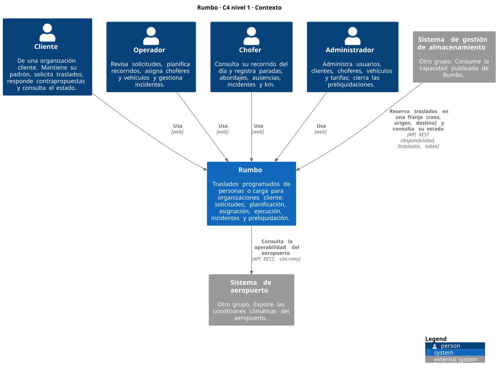
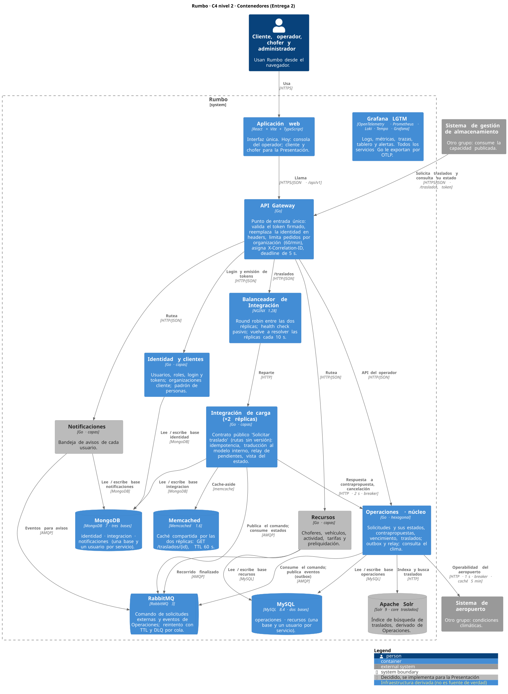

# Rumbo — Arquitectura

> Explica la arquitectura general mediante texto y diagramas. Debe permitir reconocer los servicios, sus responsabilidades, los datos que administra cada uno, sus comunicaciones y la distribución de los componentes (consigna §3).
> Las decisiones y sus justificaciones están en [`adr/`](adr/README.md); acá se describe el resultado.

## 1. Diagrama de contexto

Fuente: [`diagramas/c4-contexto.puml`](diagramas/c4-contexto.puml) (C4-PlantUML; cómo regenerarlo en [`diagramas/README.md`](diagramas/README.md)).

- Rumbo tiene cuatro tipos de usuario, que lo usan a través de la web: **cliente** (de una organización), **operador**, **chofer** y **administrador**.
- Se integra con dos sistemas de otros grupos:
  - el **sistema de gestión de almacenamiento** (otro grupo) consume la capacidad publicada **"Reservar traslado"** (API REST en `/disponibilidad` y `/traslados`): reservar el traslado de una cosa desde un origen hasta un destino en una franja, con respuesta inmediata;
  - Rumbo consume las **condiciones climáticas** del **sistema de aeropuerto**.

## 2. Diagrama de contenedores

Fuente: [`diagramas/c4-contenedores.puml`](diagramas/c4-contenedores.puml). En gris, lo que ya está decidido y se implementa para la Presentación Grupal.

- Una **aplicación web** y un **API Gateway** como punto de entrada único: token firmado, ruteo, límite de pedidos y correlation id.
  - La web es para los usuarios de Rumbo (operador, chofer, cliente y administrador) y habla solo con el gateway. Se construye para la Presentación Grupal.
  - **No ofrece la capacidad publicada:** esa es solo una API para otros sistemas (ADR-021).
  - La consola del operador de la Entrega 2 se eliminó el 2026-10-28: revisaba y contraproponía las solicitudes externas, un flujo que ADR-021 reemplazó. Sigue en el historial de Git (tag `entrega-2`).
- **Cinco microservicios en Go:** Identidad y clientes, Operaciones (núcleo), Recursos, Notificaciones e Integración de carga.
  - Integración corre en **dos réplicas** detrás de un balanceador **NGINX** (D12, [ADR-009](adr/ADR-009-balanceo.md)).
- **Almacenamiento:** una base de datos por microservicio, dos en **MySQL** y tres en **MongoDB**. Cada servicio accede solo a la suya.
- **RabbitMQ** para la mensajería asíncrona.
- **Memcached** como caché compartida de Integración (D7, [ADR-007](adr/ADR-007-cache.md)).
- **Apache Solr** como motor de búsqueda de traslados (D6, [ADR-011](adr/ADR-011-busqueda.md)), que se implementa para la Presentación.
- **Grafana LGTM** para logs, métricas, trazas, tablero y alertas (D11, [ADR-014](adr/ADR-014-observabilidad.md)).

## 3. Servicios
Cinco microservicios detrás de un API Gateway. Justificación en [ADR-001](adr/ADR-001-limites-de-los-servicios.md) (D1).

| Servicio | Responsabilidad | Datos de los que es dueño |
| --- | --- | --- |
| **Identidad y clientes** | Quién es cada usuario, qué puede hacer y a qué organización y padrón pertenece | Usuarios, roles y credenciales; organizaciones cliente; padrón de personas transportadas |
| **Operaciones** | Recibir lo que hay que trasladar (incluidas las reservas de franjas), planificarlo, asignarlo y seguir su ejecución | Solicitudes, franjas y su cupo, planes, traslados y tramos, recorridos y paradas, asignaciones, incidentes |
| **Recursos** | Con qué y con quién se traslada, y cuánto le corresponde a cada chofer | Choferes (jornada, ausencias), vehículos (capacidad, accesibilidad, propietario), actividad, tarifas, preliquidaciones |
| **Notificaciones** | Hacer llegar a cada usuario sus avisos | Bandeja de avisos por usuario |
| **Integración de carga** | Atender el contrato público "Reservar traslado" y traducirlo al modelo interno | Copia de las reservas externas (idempotencia, último estado conocido) |

- Las operaciones críticas (**reserva de franja** y **asignación**) viven enteras en Operaciones ([ADR-022](adr/ADR-022-consistencia-y-concurrencia.md)).
- Operaciones consulta a Recursos (disponibilidad y vehículo) y a Identidad y clientes (padrón, del que guarda una copia en el traslado).
- Recursos y Notificaciones reciben eventos de Operaciones (recorrido finalizado, avisos).
- La capacidad publicada entra por el Gateway a **Integración de carga**, que le pide la reserva a Operaciones por HTTP (respuesta inmediata) y recibe los cambios de estado por eventos. Las decisiones de negocio las toma Operaciones ([ADR-021](adr/ADR-021-capacidad-de-autoservicio.md)).
- La capacidad consumida (clima) sale desde Operaciones.
### 3.1 Organización interna de cada servicio (bajo nivel)
La consigna pide al menos dos estilos de arquitectura distintos. Justificación en [ADR-010](adr/ADR-010-estilos-internos.md) (D2); esta es la estructura con la que se empezó:

| Servicio | Estilo | Estructura |
| --- | --- | --- |
| **Operaciones** | **Hexagonal** (teórico 8): es el núcleo, tiene las reglas e invariantes más complejas y la mayor cantidad de dependencias externas (MySQL, Recursos, Identidad, clima, broker) | `dominio/` (entidades y reglas, sin tags json/db) · `aplicacion/` (casos de uso) · `puertos/` (contratos de entrada y salida) · `adaptadores/` (`api` HTTP, `mysql`, `mensajeria`, `recursos`, `identidad`, `clima`) |
| **Identidad y clientes**, **Recursos**, **Notificaciones**, **Integración de carga** | **Capas** (Handler → Service → Repository, estilo del práctico): lógica más simple y una sola base cada uno | `controllers/` · `services/` · `repositories/` · `models/` · `database/` · `messaging/` (si usa el broker) · `clients/` (Integración → Operaciones) |
| **API Gateway** | Reverse proxy con middlewares | `entrada/` (correlation id, identidad del token en headers) · `autenticacion/` (token firmado, `golang-jwt/jwt/v5`) · `limite/` (60 pedidos por minuto por organización, `x/time/rate`) · `proxy/` (ruteo, 502/504 con Problem Details, deadline de 5 s) · `metricas/` |

Cada servicio es un módulo Go independiente (`servicios/<servicio>/`) con su `Dockerfile`, su puerto y su configuración por variables de entorno. Lo que no es negocio y comparten todos (observabilidad, mensajería con reintentos y DLQ, identidad propagada por el gateway y errores Problem Details) está en el módulo **`servicios/comun`**, y el contrato interno entre servicios en [`interfaces-internas.md`](interfaces-internas.md). `main.go` arma las dependencias a mano (infraestructura → repositorios o adaptadores → servicios o casos de uso → handlers). Los endpoints internos y los mensajes que publica y consume cada servicio están en [`interfaces-internas.md`](interfaces-internas.md).

## 4. Datos y persistencia
Detalle en [ADR-003](adr/ADR-003-persistencia.md) (D3); el motor relacional es MySQL desde [ADR-005](adr/ADR-005-mysql-como-motor-relacional.md).

| Servicio | Almacenamiento | Motivo principal |
| --- | --- | --- |
| Operaciones | MySQL, base `operaciones` | Reserva de recursos con ACID; muchas relaciones; transacción con bloqueo por recurso (`SELECT … FOR UPDATE`) contra asignaciones superpuestas; outbox e idempotencia en la misma transacción |
| Recursos | MySQL, base `recursos` | Preliquidación (montos, correcciones, cierres): finanzas y auditoría |
| Identidad y clientes | MongoDB, base `identidad` | Padrón con esquema variable por tipo de servicio (discriminador + JSON Schema) |
| Notificaciones | MongoDB, base `notificaciones` | Avisos independientes, leídos por usuario y fecha |
| Integración de carga | MongoDB, base `integracion` | Copia de la reserva externa leída como unidad; reserva, clave de idempotencia y última vista en un mismo documento |

- **Una base de datos por microservicio**, cada una con su propio usuario. Las bases viven en una instancia por motor.
- El índice de búsqueda, la caché y el broker son derivados, no fuente de verdad.
- **Operación con garantías de consistencia: la reserva de una franja** ([ADR-022](adr/ADR-022-consistencia-y-concurrencia.md), D4). En una transacción de MySQL:
  - se resuelve la `Idempotency-Key`;
  - se bloquea la fila de la franja (`SELECT … FOR UPDATE`);
  - se verifica y descuenta el cupo;
  - se crean la solicitud y el traslado, y el evento va al outbox.

  Nunca se reserva más que el cupo, un reintento no reserva dos veces y el evento no se pierde. Hay un test de concurrencia contra MySQL real: 20 reservas simultáneas sobre 3 lugares dan exactamente 3. La asignación de chofer y vehículo sigue la misma receta.

## 5. Comunicación entre servicios
Detalle en [ADR-004](adr/ADR-004-comunicacion-entre-servicios.md) (D5).

**Síncrona (HTTP/JSON, deadline propagado con `context`):**
| Llamada | Timeout | Si falla |
| --- | --- | --- |
| Cliente → Gateway → servicio | 5 s total; el gateway no reintenta | 502 / 504; reintenta el cliente con `Idempotency-Key` |
| Operaciones → Recursos (disponibilidad, vehículo) | 800 ms, 1 reintento con jitter | Se rechaza la asignación (fail-closed) |
| Operaciones → Identidad (datos de personas) | 800 ms, 1 reintento con jitter | La solicitud no se acepta; sigue `RECIBIDA` |
| Integración de carga → Operaciones (disponibilidad, reserva, cancelación) | 2 s, sin reintento, circuit breaker | 503 al consumidor, que reintenta con la misma clave ([ADR-021](adr/ADR-021-capacidad-de-autoservicio.md)) |

**Asíncrona (RabbitMQ):**
- Eventos en exchanges `topic` por productor (`rumbo.operaciones`, `rumbo.recursos`), con una cola por servicio consumidor.
- La reserva de la capacidad publicada es **síncrona** (el consumidor necesita la respuesta en el momento, ADR-021); ya no hay comando en cola.
- **Evento de dominio principal:** `operaciones.recorrido.finalizado` → Recursos registra la actividad.
- Garantías: outbox, entrega at-least-once, ACK después del efecto, consumidores idempotentes, 3 reintentos con backoff y jitter, DLQ por cola con dueño y alerta.

**Correlación:** el `X-Correlation-ID` se asigna en el gateway y se propaga en HTTP y en los mensajes.

## 6. Integración con otros grupos
- **Capacidad publicada — Reservar traslado** ([ADR-021](adr/ADR-021-capacidad-de-autoservicio.md), sobre [ADR-002](adr/ADR-002-contrato-propio.md), [ADR-006](adr/ADR-006-contrato-generico-v2.md) y [ADR-019](adr/ADR-019-contrato-sin-version-en-la-ruta.md)): API REST descrita en OpenAPI 3.1, contrato **4.0.0** ([`contracts/`](contracts/README.md)).
  - Es de **autoservicio**: el sistema externo consulta las franjas con lugar (`GET /disponibilidad`) y reserva una (`POST /traslados`). La respuesta es definitiva en el momento: `201` con el traslado `PROGRAMADO`, o `409 SIN_DISPONIBILIDAD`. No hay revisión del operador ni contrapropuesta.
  - El seguimiento es por consulta y la cancelación se aplica en el momento (si es tardía, queda marcada).
  - Es genérica: `cosa`, `origen` y `destino`, más la franja.
  - Entra por el API Gateway (token firmado) y la atiende **Integración de carga**, que le pide la reserva a Operaciones por HTTP.
  - Los `POST` son idempotentes, los errores usan Problem Details y hay un mock generado con Prism.
  - Las versiones 1.0.0, 2.1.0 y 3.0.0 quedaron reemplazadas; ninguna tuvo consumidores fuera del mock.
- **Rutas del gateway:** contrato público en `/auth/`, `/disponibilidad` y `/traslados` (sin versión); API interna de la aplicación web en `/api/<servicio>/`. Ninguna ruta lleva versión ([ADR-019](adr/ADR-019-contrato-sin-version-en-la-ruta.md)).
- **Capacidad consumida — Clima del sistema de aeropuerto** ([ADR-012](adr/ADR-012-consumo-clima.md), [ADR-020](adr/ADR-020-contrato-clima-2.md)): Operaciones consulta la operabilidad del aeropuerto (`GET /airports/SACO/conditions`, contrato 2.0.1 fijado en [`contracts/consumidos/`](contracts/consumidos/README.md); la URL real del proveedor se configura con `CLIMA_URL`, por defecto el mock) al aceptar un traslado al aeropuerto dentro de las próximas 6 h; si no es operable, el traslado queda con alerta climática y decide el operador. Es fail-open (si el proveedor falla, la alerta queda "clima no verificado" y la aceptación sigue), con timeout de 1 s, un reintento solo ante errores transitorios, circuit breaker (5 fallas, 30 s), caché local de 5 min y test de contrato con `kin-openapi`.

## 7. Búsqueda, caché y balanceo de carga
**Caché** ([ADR-007](adr/ADR-007-cache.md), D7): **Memcached**, compartido por las dos réplicas de Integración de carga, con el patrón **cache-aside** sobre la consulta por id del contrato público (`GET /traslados/{id}`), implementado como decorador del repositorio. La clave incluye la organización (`integracion:solicitud:{organizacion_id}:{solicitud_id}:v1`), el TTL es de **60 s** (más un jitter de 0 a 10 s) y la clave se **invalida** (se borra) cada vez que se aplica un evento de Operaciones o una escritura propia. Si Memcached falla o tarda más de 100 ms, se lee de MongoDB: la caída de la caché nunca produce un error. Se mide con `rumbo_cache_operaciones_total{cache="solicitudes", resultado="hit|miss|error"}`.

**Balanceo** ([ADR-009](adr/ADR-009-balanceo.md), D12): **NGINX** delante de dos réplicas de Integración de carga (`integracion-1` e `integracion-2`), con **round robin**. El gateway envía `/traslados` a `balanceador-integracion`. Los *health checks* son pasivos (3 fallas en 30 s sacan a la réplica de rotación durante 30 s) y NGINX reintenta en la otra réplica solo ante caída, timeout, `502` o `503`, y **solo en métodos idempotentes**: un `POST` nunca se reintenta en el balanceador. El log de acceso de NGINX registra qué réplica atendió cada request, y cada réplica identifica sus logs y métricas con el atributo `instancia`.

**Búsqueda** ([ADR-011](adr/ADR-011-busqueda.md), D6): **Apache Solr** con un core `traslados`, dueño Operaciones. El índice se actualiza por eventos con un indexador idempotente (solo aplica versiones más nuevas), se puede reconstruir desde MySQL y tiene un retraso máximo tolerable de 5 s. Se implementa para la Presentación Grupal.

## 8. Resiliencia y observabilidad
Dependencias de cada servicio y qué pasa cuando fallan ([ADR-008](adr/ADR-008-resiliencia.md), D10):

| Servicio | Dependencia | Si falla o tarda | Mecanismo |
| --- | --- | --- | --- |
| Integración de carga | **Operaciones** (HTTP: disponibilidad, reservar, cancelar) | Responde `503 SERVICIO_NO_DISPONIBLE` con `Retry-After`. El consumidor reintenta con la misma `Idempotency-Key` y nunca reserva dos veces. Las consultas de traslados ya reservados siguen funcionando (salen de la copia de Integración) | Timeout de 2 s + **circuit breaker** ([ADR-021](adr/ADR-021-capacidad-de-autoservicio.md)) |
| Integración de carga | RabbitMQ (recibir estados) | Las reservas siguen funcionando; la copia local se atrasa hasta que el broker vuelve y el consumidor se retoma solo | Reconexión ([ADR-017](adr/ADR-017-reconexion-broker-y-balanceador.md)) |
| Integración de carga | Memcached | Lee de MongoDB; nunca un error al consumidor | Degradación (ADR-007) |
| Integración de carga | MongoDB (su base) | `503 SERVICIO_NO_DISPONIBLE` | Timeout del driver |
| Operaciones | Sistema de aeropuerto (clima) | Sigue sin el dato: alerta "clima no verificado" (fail-open) | Timeout + reintento + breaker + caché (D9) |
| Operaciones | MySQL (su base) | `503` en sus endpoints; los mensajes se reintentan y, agotados, van a la DLQ | Timeout + reintentos de mensajería |
| Todos | RabbitMQ (al arrancar o durante la ejecución) | El proceso sigue vivo y atiende HTTP; se reconecta en segundo plano con backoff y jitter (hasta 30 s) y los consumidores se retoman solos | `mensajeria.Conectar` ([ADR-017](adr/ADR-017-reconexion-broker-y-balanceador.md)) |

**Circuit breaker** (`github.com/sony/gobreaker/v2`) en las llamadas de Integración a Operaciones: se abre con 5 fallas consecutivas o con 50 % de fallas en al menos 10 llamadas dentro de 60 s (solo cuentan timeouts, errores de red y `5xx`; un `4xx` no), responde `503` con `Retry-After: 30` sin llamar a Operaciones, pasa a semiabierto a los 30 s con 1 llamada de prueba y su estado se ve en `rumbo_circuito_estado{dependencia="operaciones"}`.

### Observabilidad
Detalle en [ADR-014](adr/ADR-014-observabilidad.md) (D11); los logs, en [ADR-023](adr/ADR-023-logs-en-mysql.md).

- **Stack:**
  - OpenTelemetry en todos los servicios Go (módulo `servicios/comun/observabilidad`) para métricas y trazas;
  - una imagen, `grafana/otel-lgtm`, que reúne el colector OTLP, Prometheus (métricas), Tempo (trazas) y Grafana (tablero y alertas) en `http://localhost:3000`;
  - un **MySQL de logs** aparte (`mysql-logs`, base `observabilidad`) que Grafana lee con un usuario de solo lectura.

  Todo se activa con el perfil `observabilidad` de `compose.yaml`.
- **Logs:** `slog` en JSON por stdout y, en lotes y en segundo plano, a la tabla `logs` de MySQL (INFO, WARN y ERROR; retención de 7 días). Llevan `servicio`, `instancia`, `correlation_id`, `trace_id` y `span_id`.
  - Si el MySQL de logs está lento o caído, la request no espera: el log se descarta, se cuenta en `rumbo_logs_descartados_total` y sigue en stdout.
  - El gateway asigna el `X-Correlation-ID`, que viaja por HTTP y en los mensajes de RabbitMQ.
- **Métricas principales:** `rumbo_http_duracion_segundos` (RED por servicio e instancia), `rumbo_mensajes_procesados_total` (incluye la DLQ), `rumbo_outbox_pendientes`, `rumbo_cache_operaciones_total`, `rumbo_circuito_estado`, `rumbo_gateway_rechazos_total`, `rumbo_solicitudes_total`, `rumbo_clima_consultas_total` y `rumbo_logs_descartados_total` (nombres fijos en `docs/interfaces-internas.md` §8).
- **Trazas:** propagación W3C Trace Context por HTTP y por RabbitMQ, incluido el paso por el outbox. El flujo principal se ve en una sola traza: gateway → Integración (`POST /traslados`) → Operaciones (`POST /internas/reservas`) → publicar `operaciones.solicitud.aceptada` → consumir en Integración.
- **Tablero:** "Rumbo — estado general" (carpeta *Rumbo*), con 14 paneles. Se provisiona desde `infra/grafana/`.
  - **Métricas (Prometheus):** requests, errores 5xx y latencia p95 por servicio, requests por instancia de Integración (balanceo), hit ratio de las cachés, pendientes de outbox, mensajes por resultado, estado de los circuitos, consultas de clima, rechazos del gateway y logs descartados.
  - **Logs (MySQL):** errores recientes, logs por minuto y por nivel, y la tabla de logs filtrable por nivel, servicio y `correlation_id`. El `trace_id` de cada fila abre la traza en Tempo.
- **SLO y alertas** (provisionadas desde `infra/grafana/alertas/`): 99 % de los `POST /traslados` en menos de 300 ms y menos de 1 % de respuestas 5xx. Tres reglas con evaluación cada minuto: `SLO latencia traslados` y `SLO errores traslados` (`for: 5m`) y `Mensajes en DLQ` (`for: 1m`, porque con `5m` un mensaje aislado no llegaba a dispararla; ver [ADR-016](adr/ADR-016-validacion-d5.md)).

## 9. Distribución y despliegue
**Local (procedimiento único, consigna §2.12):** `docker compose up --build` levanta todo en contenedores:

| Contenedor | Puerto publicado | Notas |
| --- | --- | --- |
| `gateway` | **8080** | Único punto de entrada |
| `identidad`, `operaciones`, `recursos`, `notificaciones`, `integracion-1`, `integracion-2` | — | Solo accesibles a través del gateway (puertos internos 8081 a 8085; las dos réplicas de Integración usan el 8085) |
| `balanceador-integracion` | — | NGINX delante de `integracion-1` e `integracion-2` (puerto interno 80, ADR-009) |
| `memcached` | — | Caché de Integración (ADR-007) |
| `clima-mock` | 4020 | Mock del sistema de aeropuerto (Prism, contrato en `contracts/consumidos/`) |
| `lgtm` | 3000 (Grafana) · 4317/4318 (OTLP) | Solo con el perfil `observabilidad` (ADR-014) |
| `mysql-logs` | — | MySQL de logs, base `observabilidad`. Solo con el perfil `observabilidad` (ADR-023) |
| `mysql` | 13306 (en el host; 3306 dentro de Docker) | Bases `operaciones` y `recursos` |
| `mongo` | 27017 | Bases `identidad`, `notificaciones` e `integracion` |
| `rabbitmq` | 5672 · 15672 (panel) | Broker |

Los scripts de `infra/` crean, al iniciar por primera vez, una base de datos y un usuario por servicio. Los secretos salen de `.env`, que no se versiona.

**Nube** ([ADR-018](adr/ADR-018-despliegue-en-la-nube.md)): la aplicación web va a **Vercel** y el backend a **Railway**, con un servicio por contenedor de `compose.yaml` y las mismas imágenes. Solo el API Gateway tiene dominio público: es la URL de la capacidad publicada. Los secretos se cargan como variables de cada plataforma. Se implementa para la Presentación Grupal; costo estimado ≈ USD 24 por mes ([ADR-015](adr/ADR-015-capacidad-y-costos.md)).

## 10. Limitaciones conocidas y deuda técnica aceptada
- **Principal límite de capacidad ([ADR-015](adr/ADR-015-capacidad-y-costos.md)):** la CPU de la réplica de Integración. Ningún escenario llegó al límite hasta 100 req/s (p95 ≤ 5,6 ms y 0 % de errores), y `integracion-1` usa 22,7 % de un núcleo a 100 req/s sin caché. El siguiente paso es medir escalones mayores.
- **La búsqueda ([ADR-011](adr/ADR-011-busqueda.md)) se implementa para la Presentación.**
- **Operaciones corre en una sola réplica**, y desde [ADR-021](adr/ADR-021-capacidad-de-autoservicio.md) la reserva la necesita en el momento: si Operaciones cae, la capacidad publicada responde `503` (reintentable) en lugar de aceptar y procesar después.
- **El cupo de las franjas es una capacidad que Rumbo decide ofrecer, no se calcula con los vehículos reales** ([ADR-021](adr/ADR-021-capacidad-de-autoservicio.md)). El operador tiene que respetar las reservas al armar los recorridos.
- **Las reservas sobre una misma franja se atienden de a una** (bloqueo de la fila, [ADR-022](adr/ADR-022-consistencia-y-concurrencia.md)). Falta medir con k6 cómo afecta a muchas reservas simultáneas sobre la misma franja.
- **`grafana/otel-lgtm` es para desarrollo, no para producción.**
- **Los logs pueden perderse si el MySQL de logs está caído o saturado** ([ADR-023](adr/ADR-023-logs-en-mysql.md)): siguen en stdout, pero no aparecen en el tablero. Se ve en `rumbo_logs_descartados_total`.
- **El clima se midió contra el mock del proveedor** (Prism). El proveedor ya publicó su URL real (contrato 2.0.1, [ADR-020](adr/ADR-020-contrato-clima-2.md)); falta la clave para repetir la medición de [ADR-016](adr/ADR-016-validacion-d5.md). Mientras el servicio real está dormido, los traslados al aeropuerto quedan "clima no verificado".
- **Consumidores detenidos sin que el proceso caiga ([ADR-017](adr/ADR-017-reconexion-broker-y-balanceador.md)):** con RabbitMQ caído, cada servicio sigue vivo y atiende HTTP, pero no consume. Se detecta por los logs (`se cerró la conexión con RabbitMQ`) y por `rumbo_outbox_pendientes`, que crece mientras el broker no está; todavía no hay una alerta específica.
