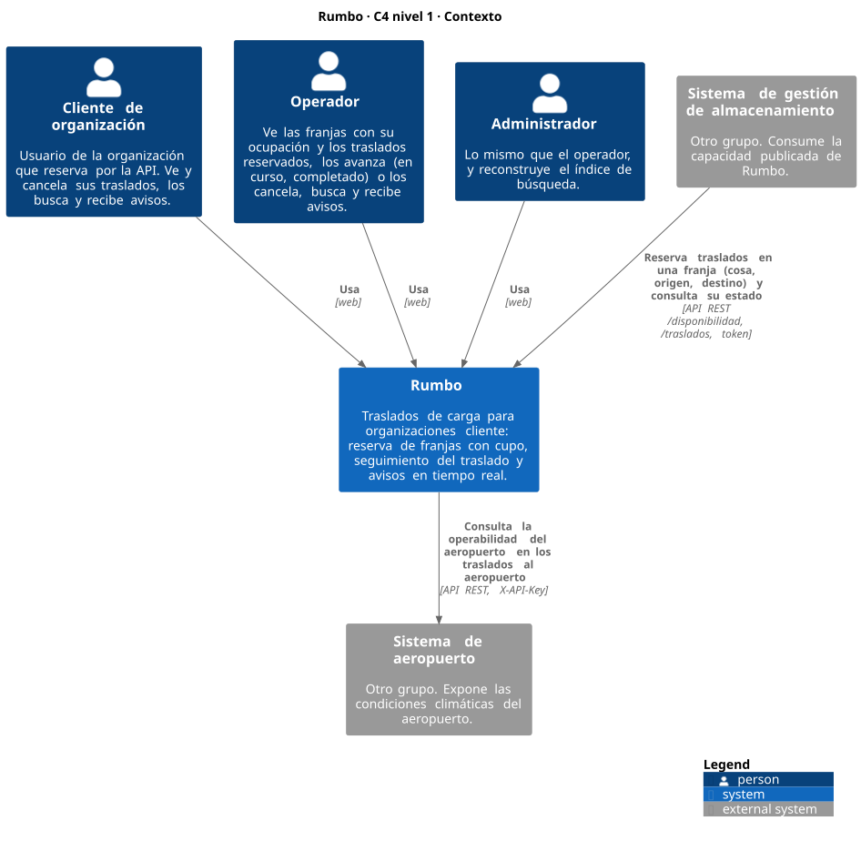
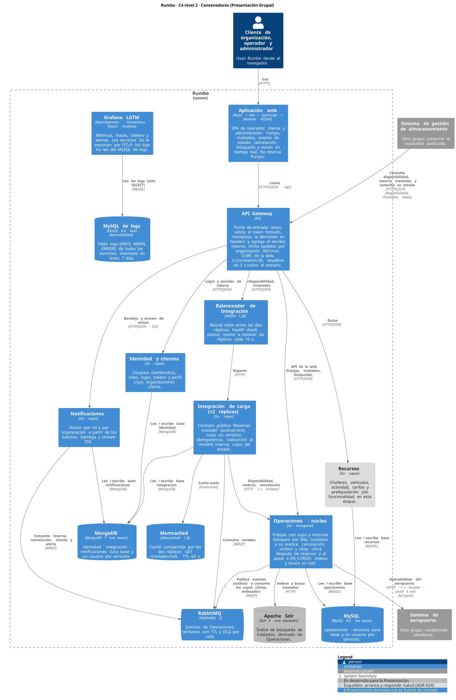

# Rumbo — Arquitectura

> Explica la arquitectura general mediante texto y diagramas. Debe permitir reconocer los servicios, sus responsabilidades, los datos que administra cada uno, sus comunicaciones y la distribución de los componentes (consigna §3).
> Las decisiones y sus justificaciones están en [`adr/`](adr/README.md); acá se describe el resultado. Estado: **Presentación Grupal** (alcance en [ADR-024](adr/ADR-024-alcance-de-la-presentacion.md)).

## 1. Diagrama de contexto

Fuente: [`diagramas/c4-contexto.puml`](diagramas/c4-contexto.puml) (C4-PlantUML; cómo regenerarlo en [`diagramas/README.md`](diagramas/README.md)).

- Rumbo tiene tres tipos de usuario en esta etapa, que lo usan a través de la web ([ADR-029](adr/ADR-029-aplicacion-web.md)):
  - **operador:** ve las franjas con su ocupación y los traslados reservados, los avanza (`EN_CURSO`, `COMPLETADO`) o los cancela, busca traslados y recibe avisos;
  - **cliente de organización:** un usuario de la organización que reserva por la API; ve y cancela sus traslados, los busca y recibe avisos;
  - **administrador:** lo mismo que el operador, y reconstruye el índice de búsqueda.

  El rol **chofer** y el resto del dominio (solicitudes desde la web, recorridos, asignación, preliquidación) están documentados en `SPEC.md` pero no se implementan en esta etapa (ADR-024).
- Se integra con dos sistemas de otros grupos:
  - el **sistema de gestión de almacenamiento** consume la capacidad publicada **"Reservar traslado"** (API REST en `/disponibilidad` y `/traslados`): reservar el traslado de una cosa desde un origen hasta un destino en una franja, con respuesta inmediata;
  - Rumbo consume las **condiciones climáticas** del **sistema de aeropuerto**.

## 2. Diagrama de contenedores

Fuente: [`diagramas/c4-contenedores.puml`](diagramas/c4-contenedores.puml).

- Una **aplicación web** y un **API Gateway** como punto de entrada único.
  - **Aplicación web** (`web/`, [ADR-029](adr/ADR-029-aplicacion-web.md)): SPA de React + Vite + TypeScript + Mantine, servida por NGINX en `http://localhost:5173`. Habla **solo con el gateway** (`/api/<servicio>/...`): la identidad la pone el gateway a partir del token y la web nunca manda headers `X-Rumbo-*`. **No reserva franjas:** la capacidad publicada es solo una API para otros sistemas ([ADR-021](adr/ADR-021-capacidad-de-autoservicio.md)). Recibe los avisos en tiempo real por un stream SSE leído con `fetch`; el stream no es la fuente de verdad: ante cada aviso invalida las consultas de React Query y vuelve a pedir los datos.
  - **API Gateway:** token firmado, ruteo, límite de pedidos, correlation id, CORS para el origen de la web, secreto interno hacia los servicios y deadline de 5 s (salvo el stream de avisos).
- **Cinco microservicios en Go:** Identidad y clientes, Operaciones (núcleo), Recursos (en esqueleto), Notificaciones e Integración de carga.
  - Integración corre en **dos réplicas** detrás de un balanceador **NGINX** (D12, [ADR-009](adr/ADR-009-balanceo.md)).
- **Almacenamiento:** una base de datos por microservicio, dos en **MySQL** y tres en **MongoDB**. Cada servicio accede solo a la suya.
- **RabbitMQ** para la mensajería asíncrona.
- **Memcached** como caché compartida de Integración (D7, [ADR-007](adr/ADR-007-cache.md)).
- **Apache Solr 9** como motor de búsqueda de traslados, con un core `traslados` del que es dueño Operaciones (D6, [ADR-011](adr/ADR-011-busqueda.md)).
- **Grafana LGTM** para métricas, trazas, tablero y alertas, y un **MySQL de logs** (D11, [ADR-014](adr/ADR-014-observabilidad.md), [ADR-023](adr/ADR-023-logs-en-mysql.md)).

## 3. Servicios
Cinco microservicios detrás de un API Gateway. Justificación en [ADR-001](adr/ADR-001-limites-de-los-servicios.md) (D1); qué se implementa en esta etapa, en [ADR-024](adr/ADR-024-alcance-de-la-presentacion.md).

| Servicio | Responsabilidad | Datos de los que es dueño | En esta etapa |
| --- | --- | --- | --- |
| **Identidad y clientes** | Quién es cada usuario, qué puede hacer y a qué organización pertenece | Usuarios, roles y credenciales; organizaciones cliente (y sus credenciales de API) | Login, tokens, perfil (`GET /yo`) y usuarios de demostración sembrados al arrancar |
| **Operaciones** | Las franjas y su cupo, las reservas y el ciclo del traslado | Solicitudes, franjas y su cupo, traslados (y, cuando se implementen, planes, recorridos, asignaciones e incidentes) | Reserva, disponibilidad, API de la web, avance de estado, cancelación, clima y búsqueda |
| **Recursos** | Con qué y con quién se traslada, y cuánto le corresponde a cada chofer | Choferes, vehículos, actividad, tarifas, preliquidaciones | **Esqueleto:** arranca y responde `/salud`. Sin recorridos no tiene consumidor ni pantalla (ADR-024) |
| **Notificaciones** | Hacer llegar los avisos | Avisos por rol y por organización | Consumidor de eventos, bandeja y stream SSE ([ADR-027](adr/ADR-027-avisos-en-tiempo-real.md)) |
| **Integración de carga** | Atender el contrato público "Reservar traslado" y traducirlo al modelo interno | Copia de las reservas externas (idempotencia, último estado conocido) | Sin cambios desde la Entrega 2 |

- **No hay revisión de solicitudes** (ADR-024): la solicitud nace de una reserva de franja, ya aceptada, con su traslado `PROGRAMADO`. El operador avanza el traslado desde la web: `PROGRAMADO` → `EN_CURSO` → `COMPLETADO` (o lo cancela). El flujo de revisión de la Entrega 2 quedó en el tag `entrega-2`.
- La operación crítica (**reserva de franja**) vive entera en Operaciones ([ADR-022](adr/ADR-022-consistencia-y-concurrencia.md)).
- La capacidad publicada entra por el Gateway a **Integración de carga**, que le pide la reserva a Operaciones por HTTP (respuesta inmediata) y recibe los cambios de estado por eventos. Las decisiones de negocio las toma Operaciones ([ADR-021](adr/ADR-021-capacidad-de-autoservicio.md)).
- **Operaciones consume sus propios eventos** para el trabajo lento que no tiene que demorar la respuesta: el clima después de reservar (cola `operaciones.clima`, [ADR-025](adr/ADR-025-clima-en-las-reservas.md)) y el índice de búsqueda (cola `operaciones.indexador`). Separa el procesamiento de la aceptación (teórico 4) sin mover la propiedad de los datos.
- La capacidad consumida (clima) sale desde Operaciones.

### 3.1 Organización interna de cada servicio (bajo nivel)
La consigna pide al menos dos estilos de arquitectura distintos. Justificación en [ADR-010](adr/ADR-010-estilos-internos.md) (D2):

| Servicio | Estilo | Estructura |
| --- | --- | --- |
| **Operaciones** | **Hexagonal** (teórico 8): es el núcleo, tiene las reglas e invariantes más complejas y la mayor cantidad de dependencias externas (MySQL, broker, clima, Solr) | `dominio/` (entidades y reglas, sin tags json/db) · `aplicacion/` (casos de uso) · `puertos/` (contratos de entrada y salida) · `adaptadores/` (`api` HTTP, `mysql`, `mensajeria`, `clima`, `solr`) |
| **Identidad y clientes**, **Recursos**, **Notificaciones**, **Integración de carga** | **Capas** (Handler → Service → Repository, estilo del práctico): lógica más simple y una sola base cada uno | `controllers/` · `services/` · `repositories/` · `models/` · `database/` · `messaging/` (si usa el broker) · `clients/` (Integración → Operaciones) |
| **API Gateway** | Reverse proxy con middlewares | `entrada/` (correlation id, identidad del token en headers) · `autenticacion/` (token firmado, `golang-jwt/jwt/v5`) · `limite/` (60 pedidos por minuto por organización, `x/time/rate`) · `proxy/` (ruteo, secreto interno, 502/504 con Problem Details, deadline de 5 s; stream sin deadline) · `despertar/` (Render) |
| **Aplicación web** | SPA con un cliente HTTP único | `src/api.ts` (token, `Idempotency-Key` por intención, Problem Details a mensajes) · `src/sse.ts` y `src/tiempoReal.ts` (stream) · `src/paginas/` |

Cada servicio es un módulo Go independiente (`servicios/<servicio>/`) con su `Dockerfile`, su puerto y su configuración por variables de entorno. Lo que no es negocio y comparten todos (observabilidad, `/salud`, mensajería con reintentos y DLQ, identidad propagada por el gateway, secreto interno y errores Problem Details) está en el módulo **`servicios/comun`**, y el contrato interno entre servicios en [`interfaces-internas.md`](interfaces-internas.md) (§11 a §16 para esta etapa). `main.go` arma las dependencias a mano (infraestructura → repositorios o adaptadores → servicios o casos de uso → handlers).

## 4. Datos y persistencia
Detalle en [ADR-003](adr/ADR-003-persistencia.md) (D3); el motor relacional es MySQL desde [ADR-005](adr/ADR-005-mysql-como-motor-relacional.md).

| Servicio | Almacenamiento | Qué guarda y por qué |
| --- | --- | --- |
| Operaciones | MySQL, base `operaciones` | Franjas con su cupo, solicitudes, traslados, outbox, mensajes procesados y claves de idempotencia. Reserva con ACID y bloqueo por fila (`SELECT … FOR UPDATE`); outbox e idempotencia en la misma transacción. Migraciones embebidas en el binario (`golang-migrate`); el listado de la web por fecha usa el índice `idx_franja_inicio` |
| Recursos | MySQL, base `recursos` | Esqueleto en esta etapa. Pensada para la preliquidación (montos, correcciones, cierres) |
| Identidad y clientes | MongoDB, base `identidad` | Usuarios (con `nombre`, roles y organización) y organizaciones con sus credenciales de API, con hash bcrypt |
| Notificaciones | MongoDB, base `notificaciones` | Colección `avisos`: `_id` = id del mensaje que lo originó (la idempotencia del consumidor), `destinatario {tipo: ROL \| ORGANIZACION, valor}`, `titulo`, `mensaje`, `entidad`, `creado_en` y `leido` (compartido por el destinatario). Índice `{destinatario.tipo, destinatario.valor, creado_en: -1}` para la bandeja y el stream ([ADR-027](adr/ADR-027-avisos-en-tiempo-real.md)) |
| Integración de carga | MongoDB, base `integracion` | Copia de la reserva externa leída como unidad; reserva, clave de idempotencia y última vista en un mismo documento |

- **Una base de datos por microservicio**, cada una con su propio usuario. Las bases viven en una instancia por motor.
- El índice de búsqueda, la caché y el broker son derivados, no fuente de verdad. El índice de Solr se reconstruye desde MySQL con `POST /api/operaciones/admin/reindexacion` sin perder nada ([ADR-011](adr/ADR-011-busqueda.md)).
- **Core `traslados` de Solr** (vista derivada de MySQL, diseñada para la lectura y no como copia de las tablas, teórico 5): un documento por traslado, con `id` = id de la solicitud.
  - **Texto:** `descripcion_texto` y `texto` (descripción, referencia externa, y nombres y direcciones de origen y destino), con el tipo propio `texto_es_rumbo`.
  - **Filtros y orden:** `organizacion_id`, `estado_traslado`, `alerta_climatica` y `franja_inicio`.
  - **Control:** `version`, la `agregado_version` del último evento aplicado.
  - **Para mostrar:** los campos de la respuesta de `interfaces-internas.md` §16.
  - El esquema lo aplica Operaciones al arrancar con la Schema API y solo agrega lo que falta.
- **Operación con garantías de consistencia: la reserva de una franja** ([ADR-022](adr/ADR-022-consistencia-y-concurrencia.md), D4). En una transacción de MySQL:
  - se resuelve la `Idempotency-Key`;
  - se bloquea la fila de la franja (`SELECT … FOR UPDATE`);
  - se verifica y descuenta el cupo;
  - se crean la solicitud y el traslado, y el evento va al outbox.

  Nunca se reserva más que el cupo, un reintento no reserva dos veces y el evento no se pierde. La cancelación devuelve el lugar a la franja en la misma transacción (R-45). Hay un test de concurrencia contra MySQL real (20 reservas simultáneas sobre 3 lugares dan exactamente 3) y una prueba de carga con k6 sobre una sola franja: 6249 reservas `201` y 6249 lugares ocupados ([informe](capacidad/informe-presentacion.md)).

## 5. Comunicación entre servicios
Detalle en [ADR-004](adr/ADR-004-comunicacion-entre-servicios.md) (D5).

**Síncrona (HTTP/JSON, deadline propagado con `context`):**
| Llamada | Timeout | Si falla |
| --- | --- | --- |
| Cliente → Gateway → servicio | 5 s total; el gateway no reintenta | 502 / 504; reintenta el cliente con `Idempotency-Key` |
| Web → Gateway → Notificaciones (stream SSE) | Sin deadline (la conexión dura minutos); comentario `: ping` cada 15 s | La web reconecta con backoff (1, 2, 4… 30 s) y `Last-Event-ID` |
| Integración de carga → Operaciones (disponibilidad, reserva, cancelación) | 2 s, sin reintento, circuit breaker | 503 al consumidor, que reintenta con la misma clave ([ADR-021](adr/ADR-021-capacidad-de-autoservicio.md)) |
| Operaciones → clima, al pasar a `EN_CURSO` | 1 s por intento, breaker, caché | Fail-open: el cambio de estado se hace igual, con "clima no verificado" ([ADR-025](adr/ADR-025-clima-en-las-reservas.md)) |
| Operaciones → Solr | 2 s | Solo la búsqueda responde `503` |

- **Secreto interno** ([ADR-026](adr/ADR-026-despliegue-en-render.md), `interfaces-internas.md` §11.2): el gateway agrega `X-Rumbo-Interno` y los servicios rechazan con `401` lo que no lo trae. Así la identidad que propaga el gateway (`X-Rumbo-Usuario`, `-Roles`, `-Organizacion`) solo puede venir del gateway, también en la nube, donde cada servicio tiene URL propia (teórico 6). Las llamadas entre servicios de Rumbo lo mandan; las llamadas a otro grupo, no.
- **`/salud`** en cada servicio (`GET` y `HEAD`): dice que el proceso está vivo, no que sus dependencias estén bien (teórico 6: vivo ≠ listo). No pide el secreto ni se mide.

**Asíncrona (RabbitMQ):**
- Eventos en el exchange `topic` `rumbo.operaciones`, con una cola por servicio consumidor.
- **Evento de dominio principal: `operaciones.solicitud.aceptada`** (la reserva, ADR-024). Lo consumen cuatro colas:

  | Cola | Consumidor | Para qué |
  | --- | --- | --- |
  | `integracion.estados` | Integración (las dos réplicas compiten) | Copia del estado que consulta el sistema externo |
  | `notificaciones.avisos` | Notificaciones | Aviso "Reserva nueva" al operador |
  | `operaciones.clima` | Operaciones | Revisar el clima después de reservar ([ADR-025](adr/ADR-025-clima-en-las-reservas.md)) |
  | `operaciones.indexador` | Operaciones | Actualizar el índice de búsqueda ([ADR-011](adr/ADR-011-busqueda.md)) |

- Los demás eventos que se producen: `operaciones.cancelacion.registrada`, `operaciones.traslado.estado_cambiado` y `operaciones.traslado.alerta_climatica`. Todos llevan la vista completa de la solicitud y su `agregado_version`, así cada consumidor aplica solo lo más nuevo.
- La reserva de la capacidad publicada es **síncrona** (el consumidor necesita la respuesta en el momento, ADR-021).
- Garantías: outbox, entrega at-least-once, ACK después del efecto, consumidores idempotentes, 3 reintentos con backoff y jitter, DLQ por cola con dueño y alerta.

**Correlación:** el `X-Correlation-ID` se asigna en el gateway y se propaga en HTTP y en los mensajes.

## 6. Integración con otros grupos
- **Capacidad publicada — Reservar traslado** ([ADR-021](adr/ADR-021-capacidad-de-autoservicio.md), sobre [ADR-002](adr/ADR-002-contrato-propio.md), [ADR-006](adr/ADR-006-contrato-generico-v2.md) y [ADR-019](adr/ADR-019-contrato-sin-version-en-la-ruta.md)): API REST descrita en OpenAPI 3.1, contrato **4.0.1** ([`contracts/`](contracts/README.md)), publicada en **https://rumbo-gateway.onrender.com** ([ADR-026](adr/ADR-026-despliegue-en-render.md)).
  - Es de **autoservicio**: el sistema externo consulta las franjas con lugar (`GET /disponibilidad`) y reserva una (`POST /traslados`). La respuesta es definitiva en el momento: `201` con el traslado `PROGRAMADO`, o `409 SIN_DISPONIBILIDAD`.
  - El seguimiento es por consulta (`EN_CURSO` y `COMPLETADO` los marca el operador) y la cancelación se aplica en el momento (si es tardía, queda marcada).
  - **4.0.1** solo aclara que `ASIGNADO`, `NO_REALIZADO` e `INTERRUMPIDO` siguen en el enum pero no se producen en esta versión: sacarlos sería un cambio incompatible para quien ya los contempla (ADR-024).
  - Entra por el API Gateway (token firmado) y la atiende **Integración de carga**, que le pide la reserva a Operaciones por HTTP. Los `POST` son idempotentes, los errores usan Problem Details y hay un mock generado con Prism.
- **Rutas del gateway:** contrato público en `/auth/`, `/disponibilidad` y `/traslados` (sin versión); API interna de la aplicación web en `/api/<servicio>/`. Ninguna ruta lleva versión ([ADR-019](adr/ADR-019-contrato-sin-version-en-la-ruta.md)).
- **Capacidad consumida — Clima del sistema de aeropuerto** ([ADR-012](adr/ADR-012-consumo-clima.md), [ADR-020](adr/ADR-020-contrato-clima-2.md), [ADR-025](adr/ADR-025-clima-en-las-reservas.md)): Operaciones consulta la operabilidad del aeropuerto (`GET /airports/SACO/conditions`, contrato 2.0.1 fijado en [`contracts/consumidos/`](contracts/consumidos/README.md); URL con `CLIMA_URL`, por defecto el mock) en los traslados cuyo origen o destino contiene una palabra de `AEROPUERTO_PALABRAS`, con la hora comprometida dentro de las próximas 6 h:
  - **después de reservar**, en forma asíncrona (consumidor propio): la reserva no espera al clima;
  - **al pasar a `EN_CURSO`**, en forma síncrona y fuera de la transacción (no se retienen bloqueos durante una llamada de red, teórico 7).

  Si no es operable, el traslado queda con alerta climática y se avisa al operador y a la organización. Es **fail-open**: si el proveedor falla, la alerta queda "clima no verificado" y la operación sigue. Timeout de 1 s, un reintento solo ante errores transitorios, circuit breaker (5 fallas, 30 s), caché local de 5 min y test de contrato con `kin-openapi`.

## 7. Búsqueda, caché y balanceo de carga
**Caché** ([ADR-007](adr/ADR-007-cache.md), D7): **Memcached**, compartido por las dos réplicas de Integración de carga, con el patrón **cache-aside** sobre la consulta por id del contrato público (`GET /traslados/{id}`), implementado como decorador del repositorio. La clave incluye la organización (`integracion:solicitud:{organizacion_id}:{solicitud_id}:v1`), el TTL es de **60 s** (más un jitter de 0 a 10 s) y la clave se **invalida** cada vez que se aplica un evento de Operaciones o una escritura propia. Si Memcached falla o tarda más de 100 ms, se lee de MongoDB: la caída de la caché nunca produce un error. En la nube no hay Memcached y Integración lee directo de MongoDB (`MEMCACHED_ADDR` vacío). Se mide con `rumbo_cache_operaciones_total{cache="solicitudes", resultado="hit|miss|error"}`.

**Balanceo** ([ADR-009](adr/ADR-009-balanceo.md), D12): **NGINX** delante de dos réplicas de Integración de carga (`integracion-1` e `integracion-2`), con **round robin**. El gateway envía `/traslados` a `balanceador-integracion`. Los *health checks* son pasivos (3 fallas en 30 s sacan a la réplica de rotación durante 30 s) y NGINX reintenta en la otra réplica solo ante caída, timeout, `502` o `503`, y **solo en métodos idempotentes**: un `POST` nunca se reintenta en el balanceador. Cada réplica identifica sus logs y métricas con el atributo `instancia`.

**Búsqueda** ([ADR-011](adr/ADR-011-busqueda.md) con el alcance de ADR-024, D6, `interfaces-internas.md` §16): **Apache Solr** con un core `traslados`, dueño Operaciones (adaptador de salida, no un servicio aparte). `GET /api/operaciones/traslados/busqueda` con texto libre, filtros (organización, estado, rango de fechas y alerta climática), orden por fecha o relevancia y paginación; **al cliente se le fuerza su organización**. El índice se actualiza por eventos con un indexador idempotente (solo aplica versiones más nuevas), se reconstruye desde MySQL y tiene un retraso máximo tolerable de 5 s (p95). Si Solr cae, solo la búsqueda responde `503`.
- **Análisis del texto en español** (tipo `texto_es_rumbo`, igual al indexar y al consultar): tokenizador estándar → minúsculas → stopwords en español → sin tildes → plural a singular (`SpanishMinimalStem`). Así "Cajas", "caja" y "CAJA" quedan como `caja`, y "mercadería" como `mercaderia`. El `text_es` de Solr no servía: dejaba "cajas" como `caj` y "caja" como `caja`, y buscar "caja" no encontraba "Cajas".
- **Filtro ≠ ranking:**
  - el texto va en `q` con eDisMax y boost `qf=descripcion_texto^3 texto`, así lo que se traslada pesa más que los nombres y las direcciones;
  - los filtros van en `fq`, que restringe sin cambiar el puntaje, y los literales con `{!term}`, así un valor del usuario no se interpreta como sintaxis de Solr.
- **Indexador:** cola `operaciones.indexador`. Escribe con versión monotónica y concurrencia optimista de Solr, sin bloqueos:
  1. real-time get de la versión indexada; si es igual o mayor, no hace nada (evento repetido o viejo);
  2. si no, escribe con `_version_` = la leída (o `-1` si no existía);
  3. si otra escritura ganó en el medio, Solr responde `409` y se repite, hasta 5 veces.

  Hay un soft commit en cada escritura, así el cambio queda visible enseguida. Las solicitudes sin traslado no se indexan.
- **Reindexación:** `POST /admin/reindexacion` (solo administrador) responde `202` y recorre MySQL en segundo plano, de a 200 solicitudes por transacción, con la misma regla de versión.
- **Medido** (PR #29):
  - una reserva nueva aparece en la búsqueda a los 0,64 s (`demora_segundos` 0,51; panel 15 y `rumbo_indexacion_demora_segundos`);
  - la reindexación de 12 505 traslados tarda ~61 s (~205 por segundo);
  - con Solr detenido, la búsqueda da `503` y reservar y avanzar siguen en `201` y `200`; al volver Solr, el traslado aparece con el estado nuevo a los 7,1 s (CA-43).

## 8. Resiliencia y observabilidad
Dependencias de cada servicio y qué pasa cuando fallan ([ADR-008](adr/ADR-008-resiliencia.md), D10):

| Servicio | Dependencia | Si falla o tarda | Mecanismo |
| --- | --- | --- | --- |
| Integración de carga | **Operaciones** (HTTP: disponibilidad, reservar, cancelar) | Responde `503 SERVICIO_NO_DISPONIBLE` con `Retry-After`. El consumidor reintenta con la misma `Idempotency-Key` y nunca reserva dos veces. Las consultas de traslados ya reservados siguen funcionando (salen de la copia de Integración). Verificado con una caída provocada de 8 min ([postmortem](POSTMORTEM.md)) | Timeout de 2 s + **circuit breaker** ([ADR-021](adr/ADR-021-capacidad-de-autoservicio.md)) |
| Integración de carga | RabbitMQ (recibir estados) | Las reservas siguen funcionando; la copia local se atrasa hasta que el broker vuelve y el consumidor se retoma solo | Reconexión ([ADR-017](adr/ADR-017-reconexion-broker-y-balanceador.md)) |
| Integración de carga | Memcached | Lee de MongoDB; nunca un error al consumidor | Degradación (ADR-007) |
| Integración de carga | MongoDB (su base) | `503 SERVICIO_NO_DISPONIBLE` | Timeout del driver |
| Operaciones | Sistema de aeropuerto (clima) | **Después de reservar** (asíncrono): la reserva no espera ni cambia su latencia; un clima caído no reintenta el mensaje ni lo manda a la DLQ: queda "clima no verificado". **Al pasar a `EN_CURSO`** (síncrono): el cambio de estado se hace igual, con "clima no verificado" | Timeout + reintento + breaker + caché, fail-open (D9, ADR-025) |
| Operaciones | Solr | Solo la búsqueda responde `503`; reservar, avanzar y cancelar siguen igual. El indexador reintenta y, agotados los reintentos, DLQ (lo recupera la reindexación) | Timeout de 2 s + reintentos de mensajería |
| Operaciones | MySQL (su base) | `503` en sus endpoints; los mensajes se reintentan y, agotados, van a la DLQ | Timeout + reintentos de mensajería |
| Notificaciones | MongoDB (su base) | `503` en la bandeja y al abrir el stream; con el stream abierto, se loguea y se reintenta en la consulta siguiente sin saltear avisos | Timeout del driver |
| Notificaciones | RabbitMQ | Los avisos esperan en el outbox de Operaciones y llegan al volver | Outbox + reconexión |
| Todos | RabbitMQ (al arrancar o durante la ejecución) | El proceso sigue vivo y atiende HTTP; se reconecta en segundo plano con backoff y jitter (hasta 30 s) y los consumidores se retoman solos | `mensajeria.Conectar` ([ADR-017](adr/ADR-017-reconexion-broker-y-balanceador.md)) |

**Circuit breaker** (`github.com/sony/gobreaker/v2`) en las llamadas de Integración a Operaciones: se abre con 5 fallas consecutivas o con 50 % de fallas en al menos 10 llamadas dentro de 60 s (solo cuentan timeouts, errores de red y `5xx`; un `4xx` no), responde `503` con `Retry-After: 30` sin llamar a Operaciones, pasa a semiabierto a los 30 s con 1 llamada de prueba y su estado se ve en `rumbo_circuito_estado{dependencia="operaciones"}`. En la caída provocada se abrió a los 35–41 s y se cerró solo a los 24–32 s de volver Operaciones ([postmortem](POSTMORTEM.md)).

**Pruebas de punta a punta** ([ADR-028](adr/ADR-028-tests-de-punta-a-punta.md)): además de los tests de cada módulo, el CI tiene un job `e2e` que levanta el sistema con `docker compose up --build -d --wait` (sin observabilidad) y corre `pruebas/e2e` contra el gateway: flujo principal (reserva → avance → estado visible para el sistema externo → avisos), idempotencia, franja llena, cancelación del cliente y sin token.

### Observabilidad
Detalle en [ADR-014](adr/ADR-014-observabilidad.md) (D11); los logs, en [ADR-023](adr/ADR-023-logs-en-mysql.md).

- **Stack:**
  - OpenTelemetry en todos los servicios Go (módulo `servicios/comun/observabilidad`) para métricas y trazas;
  - una imagen, `grafana/otel-lgtm`, que reúne el colector OTLP, Prometheus (métricas), Tempo (trazas) y Grafana (tablero y alertas) en `http://localhost:3000`;
  - un **MySQL de logs** aparte (`mysql-logs`, base `observabilidad`) que Grafana lee con un usuario de solo lectura.

  Todo se activa con el perfil `observabilidad` de `compose.yaml`. En la nube no está: los logs van a stdout y se ven en Render.
- **Logs:** `slog` en JSON por stdout y, en lotes y en segundo plano, a la tabla `logs` de MySQL (INFO, WARN y ERROR; retención de 7 días). Llevan `servicio`, `instancia`, `correlation_id`, `trace_id` y `span_id`.
  - Si el MySQL de logs está lento o caído, la request no espera: el log se descarta, se cuenta en `rumbo_logs_descartados_total` y sigue en stdout.
  - El gateway asigna el `X-Correlation-ID`, que viaja por HTTP y en los mensajes de RabbitMQ.
- **Métricas principales:** `rumbo_http_duracion_segundos` (RED por servicio e instancia), `rumbo_mensajes_procesados_total` (incluye la DLQ), `rumbo_outbox_pendientes`, `rumbo_cache_operaciones_total`, `rumbo_circuito_estado`, `rumbo_gateway_rechazos_total`, `rumbo_solicitudes_total`, `rumbo_traslados_estado_total` (transiciones desde la web), `rumbo_clima_consultas_total` (con el atributo `momento`: reserva o inicio), `rumbo_indexacion_demora_segundos` (desde que ocurre un cambio hasta que queda visible en la búsqueda) y `rumbo_logs_descartados_total` (nombres fijos en `docs/interfaces-internas.md` §8).
- **Trazas:** propagación W3C Trace Context por HTTP y por RabbitMQ, incluido el paso por el outbox. El flujo principal se ve en una sola traza: gateway → Integración (`POST /traslados`) → Operaciones (`POST /internas/reservas`) → publicar `operaciones.solicitud.aceptada` → consumir en Integración, Notificaciones, clima e indexador.
- **Tiempo real:** cada aviso enviado por el stream loguea `demora_ms` desde que se guardó (en la prueba integrada, ~0,9 s; el objetivo de CA-41 es menos de 2 s).
- **Tablero:** "Rumbo — estado general" (carpeta *Rumbo*), con 15 paneles. Se provisiona desde `infra/grafana/`.
  - **Métricas (Prometheus):** requests, errores 5xx y latencia p95 por servicio, requests por instancia de Integración (balanceo), hit ratio de las cachés, pendientes de outbox, mensajes por resultado, estado de los circuitos, consultas de clima, rechazos del gateway, logs descartados y demora de indexación de la búsqueda (p95, objetivo 5 s).
  - **Logs (MySQL):** errores recientes, logs por minuto y por nivel, y la tabla de logs filtrable por nivel, servicio y `correlation_id`. El `trace_id` de cada fila abre la traza en Tempo.
- **SLO y alertas** (provisionadas desde `infra/grafana/alertas/`): 99 % de los `POST /traslados` en menos de 300 ms y menos de 1 % de respuestas 5xx. Tres reglas con evaluación cada minuto: `SLO latencia traslados` y `SLO errores traslados` (`for: 5m`) y `Mensajes en DLQ` (`for: 1m`, [ADR-016](adr/ADR-016-validacion-d5.md)). En la caída provocada, la de errores pasó a *Firing* a los 7 min 34 s ([postmortem](POSTMORTEM.md)). PENDIENTE-CIERRE: con el PR de los buckets (Llanca), confirmar que el p95 del tablero y la alerta de latencia miden de verdad.
- **En la nube**, un monitor externo (UptimeRobot) pide `/salud` a los cuatro servicios cada 5 minutos y avisa por mail si alguno no responde ([ADR-030](adr/ADR-030-monitor-externo-en-render.md)).

## 9. Distribución y despliegue
**Local (procedimiento único, consigna §2.12):** `docker compose up --build` levanta todo en contenedores:

| Contenedor | Puerto publicado | Notas |
| --- | --- | --- |
| `gateway` | **8080** | Único punto de entrada |
| `web` | **5173** | Aplicación web (NGINX con regla de SPA, ADR-029) |
| `identidad`, `operaciones`, `recursos`, `notificaciones`, `integracion-1`, `integracion-2` | — | Solo accesibles a través del gateway (puertos internos 8081 a 8085; las dos réplicas de Integración usan el 8085), con el secreto interno. Healthcheck por `/salud` |
| `balanceador-integracion` | — | NGINX delante de `integracion-1` e `integracion-2` (puerto interno 80, ADR-009) |
| `memcached` | — | Caché de Integración (ADR-007) |
| `solr` | 8983 (panel) | Core `traslados` (`solr-precreate`); el esquema lo aplica Operaciones (ADR-011) |
| `clima-mock` | 4020 | Mock del sistema de aeropuerto (Prism, contrato en `contracts/consumidos/`) |
| `lgtm` | 3000 (Grafana) · 4317/4318 (OTLP) | Solo con el perfil `observabilidad` (ADR-014) |
| `mysql-logs` | — | MySQL de logs, base `observabilidad`. Solo con el perfil `observabilidad` (ADR-023) |
| `mysql` | 13306 (en el host; 3306 dentro de Docker) | Bases `operaciones` y `recursos` |
| `mongo` | 27017 | Bases `identidad`, `notificaciones` e `integracion` |
| `rabbitmq` | 5672 · 15672 (panel) | Broker |

Los scripts de `infra/` crean, al iniciar por primera vez, una base de datos y un usuario por servicio. Los secretos salen de `.env`, que no se versiona.

**Nube** ([ADR-026](adr/ADR-026-despliegue-en-render.md), que reemplaza parcialmente a ADR-018, y [ADR-030](adr/ADR-030-monitor-externo-en-render.md)): **solo la capacidad publicada**, en el plan gratuito de Render, con el Blueprint [`render.yaml`](../render.yaml) y las mismas imágenes que en local. Render vuelve a desplegar con cada merge a `main`.

| Pieza | Dónde |
| --- | --- |
| `rumbo-gateway` (**https://rumbo-gateway.onrender.com**), `rumbo-identidad`, `rumbo-integracion` y `rumbo-operaciones` | Render, cuatro web services gratuitos, una instancia de cada uno |
| MongoDB de Identidad e Integración | MongoDB Atlas M0 (un cluster, bases `identidad` e `integracion`, un usuario por base) |
| MySQL de Operaciones | Aiven for MySQL, plan gratuito (`tls=skip-verify`) |
| RabbitMQ | CloudAMQP, plan Little Lemur |
| Monitor externo | UptimeRobot, `/salud` de los cuatro cada 5 minutos, hasta la Presentación |

- Los secretos (`SECRETO_INTERNO`, `TOKEN_SECRETO`, credenciales de las bases y del broker, clave del clima) se cargan en el panel de Render.
- **No van a la nube:** la aplicación web, Notificaciones, Recursos, Solr, Memcached, NGINX con la segunda réplica y Grafana. Se demuestran en local. En la nube, las rutas `/api/notificaciones/...` y `/api/recursos/...` responden `502` y la búsqueda `503`: sin `SOLR_URL`, Operaciones no levanta el indexador.
- **Arranque en frío:** en el plan gratuito un servicio se duerme a los 15 minutos sin tráfico, y **solo lo despierta un pedido desde internet**, no el de otro servicio de Render (medido el 08/11: el despertar del gateway al arrancar recibía `502` al instante). Por eso el monitor externo de ADR-030. Si quedan dormidos: `infra/render/despertar.sh`.

## 10. Limitaciones conocidas y deuda técnica aceptada
**Alcance**
- **Alcance recortado para la Presentación ([ADR-024](adr/ADR-024-alcance-de-la-presentacion.md)):** sin solicitudes desde la web, contrapropuestas, planes recurrentes, recorridos, asignación de chofer y vehículo, rol chofer, padrón ni preliquidación. Están en `SPEC.md` y en los ADR, y el código de la revisión de solicitudes quedó en el tag `entrega-2`.
- **Recursos está en esqueleto:** arranca y responde `/salud`, sin funcionalidad. El servicio y su base se mantienen porque el límite de ADR-001 sigue siendo correcto para cuando haya recorridos.
- **El operador avanza el traslado a mano** (`EN_CURSO`, `COMPLETADO`) como simplificación de la ejecución del chofer. `ASIGNADO`, `NO_REALIZADO` e `INTERRUMPIDO` siguen en el contrato pero no se producen.
- **El cupo de las franjas es una capacidad que Rumbo decide ofrecer, no se calcula con los vehículos reales** ([ADR-021](adr/ADR-021-capacidad-de-autoservicio.md)).

**Capacidad y concurrencia**
- **Principal límite de capacidad ([ADR-015](adr/ADR-015-capacidad-y-costos.md)):** ningún escenario llegó al límite. Consulta por id hasta 100 req/s (p95 ≤ 5,6 ms, 0 % de errores; `integracion-1` usa 22,7 % de un núcleo sin caché, [informe de la Entrega 2](capacidad/informe-entrega-2.md)). Reservas hasta 100 por segundo sobre una sola franja con p95 ≤ 62 ms; el principal límite por la regla de ADR-015 es `mysql` (21,5 % de un núcleo, [informe de la Presentación](capacidad/informe-presentacion.md)). El siguiente paso es medir escalones mayores.
- **Las reservas sobre una misma franja se atienden de a una** (bloqueo de la fila, [ADR-022](adr/ADR-022-consistencia-y-concurrencia.md)). Medido con k6: hasta 100 reservas por segundo sobre una sola franja se cumple el SLO, con 0 % de errores y sin sobrerreserva (6249 lugares ocupados para 6249 `201`). La espera por el bloqueo crece con la tasa y se nota en el p99 desde 50 reservas/s (93 contra 50 ms con las reservas repartidas), pero a 100 reservas/s la latencia es la misma que repartiendo entre franjas. Si la franja llegara a ser el límite, las salidas son franjas más cortas o cupo partido en varias filas.

**Fallas (del [postmortem](POSTMORTEM.md))**
- **Operaciones es punto único de falla para reservar:** corre en una sola instancia y desde ADR-021 la reserva la necesita en el momento. En la caída provocada, la capacidad no tomó reservas durante 8 min 13 s (respondió `503`, reintentable); las consultas no se afectaron. Una segunda réplica queda como deuda: el cupo ya es consistente con `FOR UPDATE` (ADR-022); el costo, según ADR-015.
- **La alerta de errores tarda:** "SLO errores traslados" pasó a *Firing* a los 7 min 34 s, mientras que el breaker abierto (`rumbo_circuito_estado` = 2) se ve a los 35 s. Falta una alerta específica por breaker abierto.
- **El histograma de latencia no tenía buckets en segundos:** el p95 del tablero marcaba 4,75 s constante y la alerta "SLO latencia traslados" disparaba con cualquier tráfico. PENDIENTE-CIERRE: lo corrige el PR de los buckets (Llanca); pasar este punto a "resuelto" con el valor medido.
- **`GET /disponibilidad` durante una caída de Operaciones** no se verificó en el postmortem.
- **Una caída larga de Solr deja el índice atrasado:** con la política de `comun` (3 reintentos, a ~1, ~4 y ~16 s), un evento que ocurre con Solr caído por más de ~21 s termina en `operaciones.indexador.dlq`, y ese cambio no se ve en la búsqueda hasta que llega un evento más nuevo del mismo traslado. Se recupera con `POST /api/operaciones/admin/reindexacion` (ADR-011). La alerta `Mensajes en DLQ` lo avisa.
- **Consumidores detenidos sin que el proceso caiga ([ADR-017](adr/ADR-017-reconexion-broker-y-balanceador.md)):** con RabbitMQ caído, cada servicio sigue vivo y atiende HTTP, pero no consume. Se detecta por los logs y por `rumbo_outbox_pendientes`; no hay una alerta específica.

**Nube (Render, [ADR-026](adr/ADR-026-despliegue-en-render.md) y [ADR-030](adr/ADR-030-monitor-externo-en-render.md))**
- **Cuota de 750 horas por mes del plan gratuito:** con el monitor, los cuatro servicios consumen ~520 h hasta la Presentación; después se pausa el monitor. Si se agota, Render suspende los servicios hasta el mes siguiente.
- **Si el monitor falla, vuelve el arranque en frío** y un servicio dormido no despierta con el tráfico de otro: hay que despertarlos con `infra/render/despertar.sh`.
- **La nube no tiene caché, balanceo, búsqueda, avisos ni observabilidad completa:** se demuestran en local.
- **Aiven con `tls=skip-verify`:** el canal va cifrado, pero sin validar la autoridad certificante.

**Otros**
- **El stream de avisos consulta MongoDB cada 1 s por conexión abierta** ([ADR-027](adr/ADR-027-avisos-en-tiempo-real.md)): sin hub en memoria, cualquier réplica sirve cualquier stream y un reinicio no pierde nada, pero el costo crece con la cantidad de pantallas abiertas.
- **El clima real:** el proveedor publicó su URL (contrato 2.0.1, [ADR-020](adr/ADR-020-contrato-clima-2.md)) y su servicio también se duerme sin pedidos (el primer pedido tarda cerca de un minuto). Con nuestro timeout de 1 s, si está dormido la alerta queda "clima no verificado" (fail-open). PENDIENTE-CIERRE: falta la clave del proveedor para medir contra el servicio real; repetir la verificación de [ADR-016](adr/ADR-016-validacion-d5.md) cuando llegue.
- **El esquema de Solr solo agrega campos:** para cambiar uno que ya existe hay que borrar el volumen `solr-datos` y reindexar (el índice es derivado: no se pierde nada).
- **Soft commit en cada escritura del indexador:** hace visible el cambio enseguida y la demora medida es la real. Con el volumen de Rumbo no pesa (0,5 s de demora, ~205 traslados por segundo al reindexar); con mucho más volumen habría que agrupar los commits (`commitWithin`).
- **`grafana/otel-lgtm` es para desarrollo, no para producción.**
- **Los logs pueden perderse si el MySQL de logs está caído o saturado** ([ADR-023](adr/ADR-023-logs-en-mysql.md)): siguen en stdout, pero no aparecen en el tablero. Se ve en `rumbo_logs_descartados_total`.
